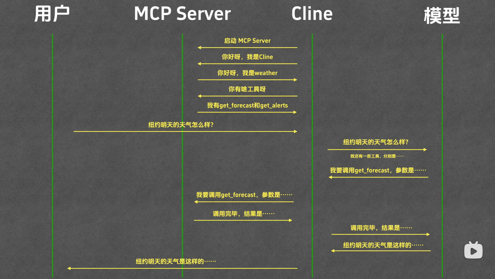

# MCP：模型控制协议

协议规范的是 mcp host(agent) 和 mcp server 之间的通信，与 LLM 无关。

MCP  server：本质是一个符合 mcp 协议的程序，主要使用 node 和 Python 编写，也可使用其他语言开发，如 java 的 spring ai。

node 开发：使用 npx command 运行；

Python 开发：使用 uv command 运行；

## mcp server 使用过程：

   * 配置/安装 mcp server；

   * 完成配置的时候，mcp server 与 mcp host 同步完成了握手：

      * 双方告知彼此的 mcp 协议版本；

      * host 询问 mcp server 具备哪些 tool，功能描述并记录；

   * 用户发起问题请求，mcp host 将问题和 mcp server 的 tool 一并发给 LLM；

   * LLM 分析后，认为需要使用某一个 mcp server 的 tool，并告知 mcp host；

   * mcp host 调用对应的 mcp server 获取到结果后，把结果发给 LLM；

   * LLM 分析整理结果，返回给 mcp host；

## 交互图

